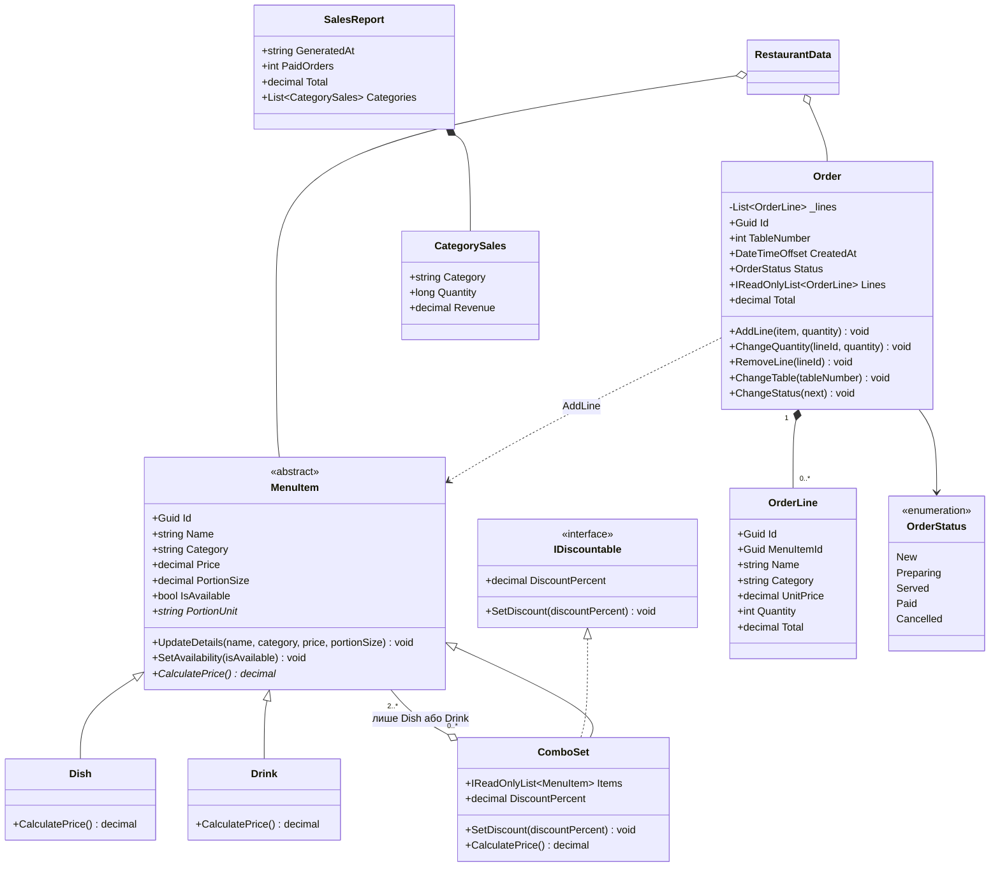
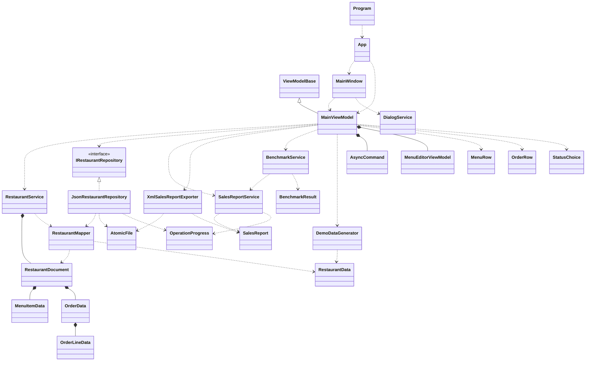
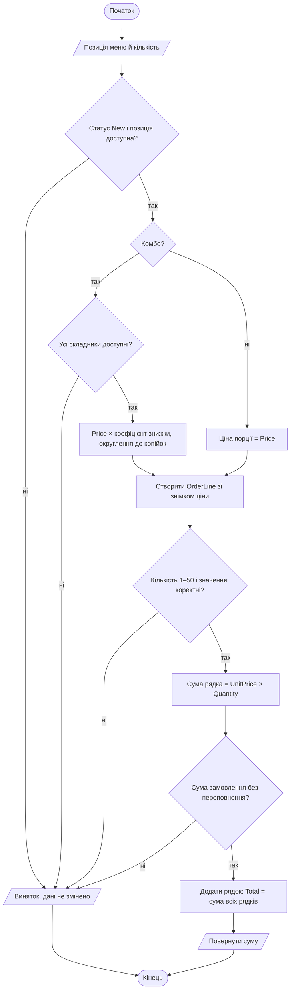
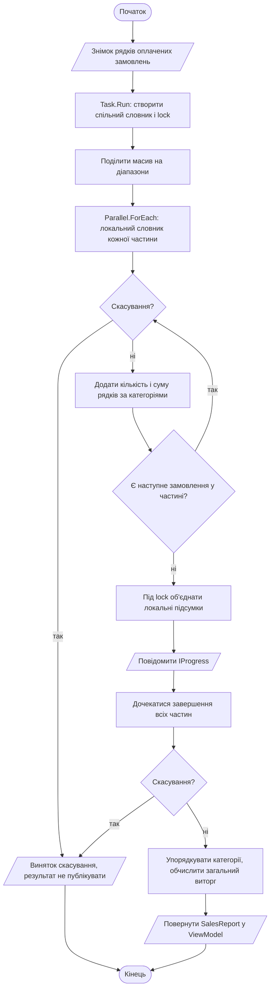

# Діаграми реалізованого коду

Стан: 08.11.2026. Схеми Mermaid відтворюють реалізацію; для вставлення в записку їх потрібно оформити за вимогами МВ.

## Модель предметної області

Сетери властивостей MenuItem та Order закриті. OrderLine має властивості лише для читання.
MenuItemId є історичним ідентифікатором, а не посиланням на живий об'єкт.
Для читабельності на схемі показано основні методи; повні сигнатури конструкторів наведено у коді.

## Сервіси, збереження та MVVM

## Додавання позиції та сума замовлення зі знижкою

## Паралельний звіт продажів

Блоки від E до J виконуються для кожного діапазону паралельно. Відображення прогресу здійснюється через Dispatcher.UIThread.
